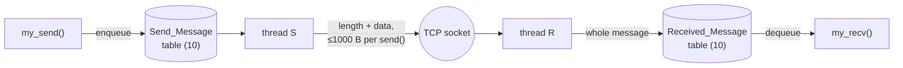

# Network Programming in C

Socket programming projects from the Computer Networks Laboratory at IIT Kharagpur (Spring 2023), written in C on POSIX sockets. They range from basic TCP clients and servers to a message-oriented transport protocol built on TCP and a traceroute-style tool on raw ICMP sockets.

| # | Project | Highlights |
|---|---------|------------|
| 5 | [**MyTCP**: message-oriented TCP](#mytcp--message-oriented-tcp) | Static library; send and receive threads; pthread mutex and condition variable; length-prefixed framing |
| 6 | [**PingNetInfo**: per-link latency and bandwidth](#pingnetinfo--per-link-latency-and-bandwidth) | Raw sockets, TTL-based hop discovery, ICMP parsing |
| 3 | [**Load balancer**](#load-balancer) | `poll()` with a running timeout, forking proxy |
| 2 | [**Remote shell**](#remote-shell) | Forking concurrent server, login, `pwd` / `dir` / `cd` over TCP |
| 1 | [**TCP client/server basics**](#tcp-clientserver-basics) | Daytime service; calculator with chunked messages |

Each folder has the original assignment statement as a PDF and a `makefile`. Run `make` to build and `make clean` to tidy up. Everything builds on Linux and macOS with `gcc` or `clang`.

---

## MyTCP – message-oriented TCP

[`05-mytcp/`](05-mytcp)

TCP is a byte stream: one `send()` of 100 bytes can arrive as several `recv()`s, and several sends can arrive merged into one. **MyTCP** is a socket layer on top of TCP that preserves message boundaries. Whatever is passed to one `my_send()` is returned by exactly one `my_recv()`, like UDP, but reliable and in order like TCP.

It is a static library, `libmsocket.a`, with the same calling pattern as the socket API:

```c
int fd = my_socket(AF_INET, SOCK_MyTCP, 0);
my_connect(fd, (struct sockaddr *)&server, sizeof(server));
my_send(fd, msg, len, 0);              // queued as one message
n = my_recv(fd, buf, sizeof(buf), 0);  // returns exactly one whole message
my_close(fd);
```

### Design



- **Framing:** each message goes on the wire as a 4-byte length in network byte order, followed by the data. Thread R reads exactly the length, then exactly that many bytes, however TCP split or merged them.
- **Threads:** S drains `Send_Message` into the socket, writing at most 1000 bytes per `send()`. R fills `Received_Message` from the socket. `my_send` and `my_recv` only touch the tables, so they never wait on the network.
- **Synchronisation:** one mutex guards the tables and connection state, and a condition variable signals every change. `my_send` blocks only while its table is full; `my_recv` blocks until a message arrives. Neither thread holds the lock while blocked in `recv()` or `send()`.
- **Semantics:**
  - Messages are up to 5000 bytes.
  - A short receive buffer truncates that one message (UDP-style) without affecting the next.
  - `my_recv` returns 0 once the peer closes.
  - `my_close` flushes queued messages before closing.
  - An iterative server can accept, serve and close one client after another.
  - A peer that disappears is detected, without crashing on `SIGPIPE`.

[`documentation.txt`](05-mytcp/documentation.txt) describes every data structure and function, and the exact sequence of events in a `my_send` and a `my_recv`.

### Build and test

```bash
cd 05-mytcp
make          # libmsocket.a + example echo server and test client
make test     # runs the echo server and the test client twice
```

The test client checks that:
- 400 messages of random sizes (1–5000 bytes), sent in bursts, come back with the same count, lengths, bytes and order
- truncation works
- oversized messages are rejected
- the server can serve a second client

It also passes under ThreadSanitizer and AddressSanitizer.

Using it in your own program:

```bash
gcc app.c -L05-mytcp -lmsocket -pthread
```

---

## PingNetInfo – per-link latency and bandwidth

[`06-pingnetinfo/`](06-pingnetinfo)

A traceroute-like tool that finds the route to a host **one link at a time** and estimates each link's latency and bandwidth.

```bash
cd 06-pingnetinfo && make
sudo ./pingnetinfo <site> <n> <T>      # e.g. sudo ./pingnetinfo 8.8.8.8 3 1
```

For each hop, it:

1. **Discovers the node.** It sends 5 ICMP Echo Requests with TTL = hop, 1 s apart. The router at that hop replies with *Time Exceeded*, or the destination with *Echo Reply*.
2. **Pings that node directly.** It sends `n` pings with no data and `n` with 1024 bytes, `T` seconds apart, and keeps the minimum RTT of each.
3. **Computes the link from the previous node X to this node Y:**
   - latency = (RTT₀(Y) − RTT₀(X)) / 2
   - bandwidth = 2 × 1024 × 8 bits / (extra(Y) − extra(X)), where extra(N) is the additional RTT the data adds on the path to N

Replies are matched to requests by ICMP identifier and sequence number, so late, out-of-order and unrelated packets are skipped. Hops that never reply are reported and skipped. Every ICMP packet sent and received is printed with its header fields. For ICMP errors such as *Destination Unreachable*, the dropped packet's IP header and TCP/UDP header are printed too.

Each estimate is a difference between small, noisy round-trip times, especially over Wi-Fi. Use a larger `n` (10 or more) for stable numbers. A link that comes out at or below zero is reported as below timing noise.

`make simulate` builds a variant that adds an artificial, size-dependent delay to every received packet, for testing on a small network where RTTs are a fraction of a millisecond.

---

## Load balancer

[`03-load-balancer/`](03-load-balancer)

Two time servers report a (random) load. Every 5 seconds the load balancer polls both for their load, and it forwards each client request to the less-loaded server. It uses `poll()` with a timeout that is recomputed after each client, so load checks stay on schedule while clients are served. Each client is handled in a forked child.

```bash
cd 03-load-balancer && make
./server 21001 &  ./server 21002 &     # two time servers
./lb 21000 21001 21002 &               # load balancer on port 21000
./client 21000                         # prints the date and time
```

---

## Remote shell

[`02-remote-shell/`](02-remote-shell)

A concurrent server (one forked child per client) that runs a small shell for logged-in users:

- The server sends `LOGIN:`. The username must be listed in [`users.txt`](02-remote-shell/users.txt).
- Supported commands are `pwd`, `dir [path]` and `cd [path]`. They are implemented with `getcwd`, `opendir`/`readdir` and `chdir`, not `system()`.
- Invalid commands reply `$$$$`, and commands that fail reply `####`. The client shows these as *Invalid command* and *Error in running command*.
- The client repeats until the user types `exit`.
- Results of any length are sent as null-terminated strings and received in small chunks.

```bash
cd 02-remote-shell && make
./sh_server &     # port 20000; run from this folder so it finds users.txt
./sh_client       # log in as deepiha or devendra
```

---

## TCP client/server basics

[`01-tcp-client-server/`](01-tcp-client-server)

- **`daytime/`**: an iterative server that sends the current date and time to each client.
- **`calculator/`**: the client sends arithmetic expressions of any length, split into 5-byte chunks. The server reassembles them and evaluates them with operator and operand stacks. As the assignment specifies, all operators have equal precedence and are left-associative, so `2+3*4` is 20; parentheses are supported. Enter `-1` to quit.

```bash
cd 01-tcp-client-server && make
./daytime/time_server &    ./daytime/time_client
./calculator/server &      ./calculator/client
```

Both servers use port 20000, so run one at a time.

---

## Authors

- **Deepiha S** (20CS30015)
- **Devendra Palod** (20CS10024)

Computer Networks Laboratory, Department of Computer Science and Engineering, IIT Kharagpur, Spring 2023.
